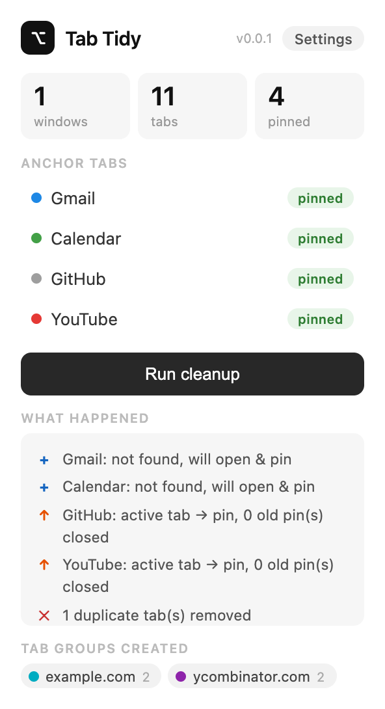

# Tab Tidy

[](https://github.com/aakarshika/tab-tidy/actions/workflows/ci.yml)
[](LICENSE)

A one-click Chrome extension that cleans up tab chaos. It merges all your windows into one, closes duplicate tabs, groups related tabs by domain, and keeps the sites you always use pinned in a fixed order.

No accounts, no network requests and no tracking: everything happens locally in your browser.

<p align="center">
  
</p>

## What a cleanup does

Click the toolbar icon and press **Run cleanup**:

1. **Resolves your anchor tabs.** For each site in your anchor list it keeps one tab and pins it. If you were actively using an unpinned copy, that copy becomes the pin and stale pins are closed.
2. **Removes duplicates.** Unpinned tabs with exactly the same URL are closed, keeping the first one.
3. **Merges windows.** Every tab moves into your focused window (or the biggest window if none is focused).
4. **Opens missing anchors.** Any anchor site without a tab gets opened and pinned.
5. **Sorts pinned tabs** into the order you configured.
6. **Places a "first" tab.** An optional tab (by default a local dev server) is placed right after the pins, and opened if it's missing.
7. **Groups by domain.** Any root domain with 2 or more unpinned tabs gets its own colored tab group.

The popup shows a live summary (windows, tabs, pins and the state of each anchor) and a log of what changed.

> [!WARNING]
> A cleanup **closes tabs** (duplicates and extra copies of anchor sites). You can bring them back with <kbd>Ctrl/Cmd</kbd>+<kbd>Shift</kbd>+<kbd>T</kbd> or from Chrome's history.

## Install

Tab Tidy isn't on the Chrome Web Store yet, so you install it from source:

1. Clone this repo (or download it as a ZIP and unzip it):
   ```bash
   git clone https://github.com/aakarshika/tab-tidy.git
   ```
2. Open `chrome://extensions` in Chrome.
3. Turn on **Developer mode** (top right).
4. Click **Load unpacked** and select the **`src/`** folder inside the repo.
5. Pin Tab Tidy to your toolbar from the puzzle-piece menu.

Works in Chrome and other Chromium browsers (Edge, Brave, Arc) that support Manifest V3 and tab groups.

## Configure

The defaults are the author's own setup, so you'll probably want to change them. Click **Settings** in the popup (or right-click the toolbar icon and choose **Options**) to:

- add, remove and reorder your **pinned anchors**, and pick a color for each;
- edit the **first unpinned tab**, or turn it off;
- **reset to defaults**.

Changes apply from the next cleanup; there's no need to reload the extension.

Each anchor has these fields:

| Field         | Meaning |
| ------------- | ------- |
| Name          | Label shown in the popup. |
| Match         | Host, optionally followed by a path prefix, without `https://`: `mail.google.com`, `claude.ai/design`. If several anchors match one tab, the longest pattern wins. |
| URL to open   | What to open when no tab matches. It has to fit the Match pattern, so the tab it opens counts as the anchor. |
| Color         | One of Chrome's tab group colors: grey, blue, red, yellow, green, pink, purple, cyan or orange. |

The options page checks your input before saving. For example, it rejects two anchors with the same pattern, because the second one would be re-opened on every cleanup.

Settings are saved with `chrome.storage.sync`, so they follow you to other computers if Chrome sync is on. The defaults themselves live in [`src/config.js`](src/config.js): they're used until you save your own settings and again after **Reset to defaults**. Edit that file only if you're changing the defaults for everyone, for example in a fork.

## Permissions

| Permission  | Why |
| ----------- | --- |
| `tabs`      | Read tab URLs to match anchors, find duplicates and group by domain. |
| `tabGroups` | Create, name and color the per-domain tab groups. |
| `storage`   | Save your settings from the options page (synced by Chrome if you have sync on). |

Tab Tidy makes no network requests. The only data it stores is your settings.

## Project structure

```
src/                      ← the extension (load this folder in Chrome)
├── manifest.json
├── config.js             ← default settings
├── settings.js           ← settings defaults and validation (unit tested)
├── background/
│   ├── index.js          ← service worker entry: message handler
│   ├── tidy.js           ← the cleanup steps, in order
│   ├── preview.js        ← read-only summary for the popup
│   ├── grouping.js       ← per-domain tab groups
│   ├── matching.js       ← pure URL helpers (unit tested)
│   ├── storage.js        ← loads and saves settings (chrome.storage.sync)
│   └── tabs.js           ← chrome.tabs / chrome.windows wrappers
├── popup/                ← toolbar popup UI
├── options/              ← options page UI
└── icons/
test/                     ← unit tests (node --test)
scripts/                  ← manifest check and release packaging
docs/                     ← images for this README
```

There is no build step: the files in `src/` are exactly what Chrome runs. Node is only used for linting, tests and packaging.

## Contributing

Bug reports, ideas and pull requests are welcome. See [CONTRIBUTING.md](CONTRIBUTING.md) to get set up. Everyone taking part is expected to follow the [Code of Conduct](CODE_OF_CONDUCT.md).

## License

[MIT](LICENSE)
